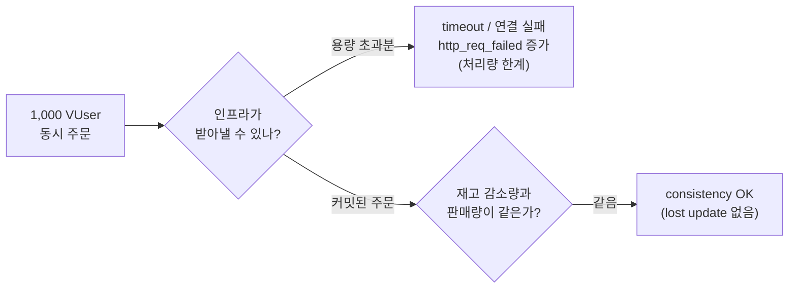
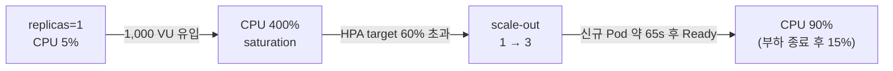
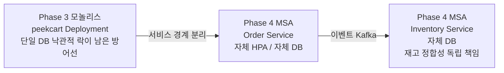

[캐시 효과 측정 글](/blog/peekcart-cache-effect-measurement/)(세션 B)은 상품 **조회** 워크로드였습니다. 캐시 ON/OFF만 토글해 TPS 2.31배를 측정했고 목표 3배 미달의 원인을 "CPU 병목 가설"까지만 좁힌 뒤 그대로 남겼습니다.  
  
이 연재는 PeekCart를 네 단계로 진행했습니다. Phase 1은 단일 Spring Boot 모놀리스로 도메인을 구현한 단계, Phase 2는 캐시, 분산 락, Kafka와 Outbox로 성능과 정합성을 보강한 단계, Phase 3은 CI, Kubernetes, 관측성, 부하 테스트로 운영 환경을 검증한 단계, Phase 4는 서비스별로 나눈 MSA 단계입니다. 이 글의 측정은 Phase 3에서 했습니다. 측정 작업은 과금 범위를 나누려고 세 세션으로 쪼갰습니다. 세션 A는 로컬 준비, 세션 B는 상품 조회 캐시 TPS 측정, 세션 C는 동시 주문 정합성, HPA, Kafka Lag 측정이고, 이 글은 세션 C를 다룹니다.  
  
조회는 읽기만 합니다. 같은 데이터를 100명이 동시에 읽어도 서로의 결과를 망가뜨리지 않습니다.  
  
하지만 **주문**은 다릅니다.  
  
> 재고가 빠듯한 상품에 주문이 한꺼번에 들어오면 재고만큼만 팔리고 나머지는 정확히 실패해야 한다.  
  
이 한 문장이 세션 C(2026-04-29)의 핵심 질문입니다. 1,001번 상품부터 1,010번까지, 각 재고 100개(총 1,000개)에 1,000명의 가상 사용자가 동시에 주문을 시도합니다. 이 테스트가 검증하려는 것은 **정합성**입니다.  
  
결과를 먼저 보면 두 가지를 동시에 얻었습니다. 하나는 성공이고 하나는 목표 미달입니다. 아래 표의 Run 1은 Pod 1개(cold-start)에서 출발한 측정, Run 2는 Pod 3개를 미리 띄워 두고 출발한 측정입니다.  
  
| 축                                    | 결과                                   | 판정   |
| ------------------------------------ | ------------------------------------ | ---- |
| 정합성 (재고 감소량 = 판매량)                   | Run 1, Run 2 모두 상품 10개 전부 `consistency=OK` | PASS |
| HPA 자동 증설                            | replicas 1에서 3으로, 신규 Pod 약 65초 만에 Ready   | PASS |
| Kafka Consumer Lag                   | steady-state 0, peak 후 5분 내 0 복귀     | PASS |
| throughput (`http_req_failed < 0.1`) | Run 1 60.59%, Run 2 35.90%           | FAIL |
  
이 표의 마지막 줄과 첫 줄은 **동시에 참**입니다. http 실패율이 60%인데 어떻게 "정합성 PASS"라고 말할 수 있을까?  
  
다만 첫 줄의 범위를 먼저 좁혀 둬야 합니다. 측정 뒤 상품별 판매량을 세어 보니 가장 많이 팔린 상품도 Run 1에서 4개, Run 2에서 14개였습니다. 재고 100개가 바닥난 상품은 하나도 없었습니다. 그래서 이 측정은 "재고만큼만 팔리고 나머지는 실패하는가"를 검증하지 못했습니다. 보여 준 것은 상품마다 재고 감소량과 판매량이 정확히 일치했다는 것, 즉 동시 갱신 중에 재고 감소가 사라지는 lost update가 없었다는 것까지입니다.  
  
---  
  
## 용어  
  
| 용어               | 이 글에서의 의미                                                                                               |
| ---------------- | ------------------------------------------------------------------------------------------------------- |
| VU / VUser       | Virtual User. k6가 흉내 내는 동시 가상 사용자                                                                       |
| 오버셀링(oversell)   | 재고보다 많이 팔리는 정합성 사고. 재고 100인데 101개 이상 판매되면 발생                                                            |
| 정합성(consistency) | 판매량 == 재고 소진량, 그리고 총 판매량 <= 초기 재고. 본 글의 1차 합격 기준                                                        |
| HPA              | Horizontal Pod Autoscaler. CPU 사용률 기준으로 Pod 수를 자동 조절하는 쿠버네티스 컨트롤러                                       |
| scale-out        | 부하가 오를 때 Pod 수(replicas)를 늘려 처리량을 확보하는 것                                                                |
| saturation       | CPU 같은 자원이 한계에 도달해 더 못 처리하는 상태. 본 글에선 Pod CPU limit(2 vCPU) 도달                                          |
| HPA utilization  | HPA가 보는 CPU 사용률. **노드가 아니라 Pod CPU request 기준**(`usage/request`). request 500m일 때 400% = 2000m = 2 vCPU |
| cold-start       | 1개 Pod로 시작해 부하를 받으며 증설되는 출발 조건                                                                          |
| pre-warmed       | 측정 전에 미리 3개 Pod로 띄워 둔 출발 조건                                                                             |
| Consumer Lag     | Kafka에서 발행된 메시지 수와 consumer가 처리한 수의 차이. 밀림의 양                                                           |
| steady-state     | 부하가 없거나 안정된 정상 상태 구간                                                                                    |
| Threshold        | k6에서 합격/불합격을 자동 판정하는 기준선                                                                                |
| p95              | 응답시간 분포의 95퍼센타일. 느린 쪽 꼬리를 보는 지표                                                                         |
| `@Version` 낙관적 락 | JPA가 UPDATE 조건에 버전을 넣어, 읽은 뒤 다른 트랜잭션이 행을 바꿨으면 충돌로 실패시키는 최후 방어선                                       |
  
---  
  
## 이번 글의 질문  
  
1. 조회 부하(세션 B)와 주문 부하(세션 C)는 무엇이 본질적으로 다를까?  
2. 1,000 VUser 동시 주문 시나리오를 어떻게 "정합성 실험"으로 설계했을까?  
3. Run 1과 Run 2를 나눠 측정해서 무엇을 분리할 수 있었을까?  
4. http 실패율 60%인데 "정합성 PASS"라고 말할 수 있는 근거는 무엇일까?  
5. 주문 경로에서 재고 정합성을 지키는 것은 분산 락인가, 낙관적 락일까?  
6. HPA 1에서 3으로 scale-out은 throughput 문제를 해결했나, 아니면 옮겼을 뿐일까?  
7. 단일 Pod에서 CPU가 1차 병목이었다면 2차 병목은 무엇일까?  
8. Kafka Lag이 0으로 돌아왔다는 것은 무엇을 보장할까?  
9. 이 측정은 Phase 4 MSA에서 어떻게 다시 쓰일까?  
  
---  
  
## 문제 상황: 조회는 충돌하지 않지만 주문은 충돌한다  
  
세션 B에서 검증한 것은 읽기 처리량이었습니다. 캐시가 잘 동작하면 빨라집니다. 정합성이라는 단어는 등장할 자리가 없었습니다. 두 사용자가 같은 상품을 동시에 조회해도 서로의 결과를 깨뜨리지 않기 때문입니다.  
  
주문은 다릅니다. 주문은 재고라는 **공유 자원을 줄인다**. 같은 상품에 동시에 주문이 집중되면 다음 사고가 가능해집니다.  
  
```text  
재고 100, 동시 주문 1,000건  
  
[정상]   100개 판매, 900건 실패 (재고 부족)  
[사고]   101개 이상 판매 → 오버셀링 → 팔 수 없는 물건을 팔아버림  
```  
  
오버셀링은 "성능이 좀 느린" 수준의 문제가 아닙니다. 이미 결제된 주문을 취소해야 하고 고객 신뢰를 잃는 **데이터 정합성 사고**입니다. Phase 2에서 분산 락과 낙관적 락을 이중으로 둔 이유가 바로 이것을 막기 위해서였습니다([분산 락 글](/blog/peekcart-inventory-lock-defense/)).  
  
문제는 이중 방어선이 **실제 동시 부하에서도 버티는지**는 동시성 테스트로 증명되지 않는다는 점입니다. `InventoryConcurrencyTest`는 스레드 몇십 개로 경합을 흉내 내지만 1,000 VUser가 실제 GKE 클러스터의 Pod에 HTTP로 동시에 요청하는 상황과는 다릅니다. CPU 포화, Pod readiness 전이, 커넥션 풀 고갈 같은 운영 변수는 통합 테스트에 없습니다.  
  
그래서 세션 C의 목표는 명확했습니다.  
  
> **실제 분산 환경의 동시 주문에서 오버셀링이 0건인가?**  
> 그리고 그때 인프라(CPU, HPA, Kafka)는 어떻게 반응하는가?  
  
---  
  
## 세션을 왜 B와 C로 쪼갰나  
  
세션 B 글에서 이미 다뤘듯, GKE는 **과금되는 1회성 세션**입니다. 클러스터를 띄운 채 측정과 디버깅을 섞으면 비용도 늘고 측정도 오염됩니다. 그래서 시작 전부터 세 세션으로 범위를 나눴습니다.  
  
```text  
세션 A: 로컬 준비 (무과금)  
세션 B: 상품 조회 캐시 TPS 측정 (2026-04-09): 캐시 효과 측정 글  
세션 C: 동시 주문 정합성 + HPA + Kafka Lag (2026-04-29): 이 글  
```  
  
세션 C는 상품 조회 부하를 **재측정하지 않는다**. 세션 B 수치를 인용만 합니다. 같은 측정을 두 번 하면 과금만 늘 뿐, 새로 알게 되는 것이 없기 때문입니다. 대신 세션 C는 네 가지를 한 번의 과금으로 묶었습니다.  
  
| 대상       | 내용                               |
| -------- | -------------------------------- |
| 동시 주문 정합성 | 1,000 VUser 동시 주문 정합성            |
| Kafka Lag 측정 | Kafka Consumer Lag               |
| HPA 검증 | HPA 1에서 3으로 런타임 검증                   |
| 병목 분석    | 세션 B의 3배 미달 원인(CPU 병목) 보강 데이터 수집 |
  
---  
  
## 실험 설계: 정합성을 어떻게 "측정"으로 바꿨나  
  
### 1. VU 1명 = 주문 시도 1회  
  
정합성을 재려면 "총 몇 번의 주문이 들어왔는가"가 통제되어야 합니다. k6 스크립트는 VU 당 정확히 한 번만 주문하도록 가드를 걸었습니다.  
  
```javascript  
// loadtest/scripts/order-concurrency.js  
export default function () {  
  if (__ITER > 0) {  
    sleep(10);   // 1m hold 구간 동안 추가 주문 없이 VU만 살려둠  
    return;  
  }  
  // ...login → cart → order (단 1회)  
}  
```  
  
두 번째 반복부터 바로 반환하는 이 가드 덕분에 각 VU는 구매 플로우를 **최대 1회**만 밟습니다. 1m hold 구간은 Grafana 타임라인 관찰용으로 VU를 살려둘 뿐, 주문을 더 발생시키지 않습니다.  
  
여기서 주의할 점: **"1,000 VU"가 곧 "POST /orders 1,000회"는 아니다.** login과 cart를 통과한 VU만 주문 요청을 보냅니다. 주문 요청을 보낸 VU는 Run 1 146명, Run 2 512명뿐입니다(아래 표의 cart 성공 수). "VU당 주문 1회" 가드 덕분에 판매 총량은 1,000을 넘을 수 없습니다. 그런데 총재고도 1,000이므로 아래 B 검사(총 판매량 1,000 이하)는 구조상 실패할 수 없습니다. 의미 있는 검사는 상품별 A 검사입니다.  
  
### 2. 경합을 일부러 만든다  
  
타깃은 `product_id 1001..1010`, 각 재고 100개(총 1,000)입니다. VU는 이 10개 중 하나를 랜덤으로 고릅니다.  
  
```javascript  
const productId = 1001 + Math.floor(Math.random() * 10);  
```  
  
상품을 1,000개로 분산시키면 경합이 거의 없어 정합성 사고가 나기 어렵습니다. 그래서 10개 상품에 1,000명을 집중시키도록 설계했습니다. 정합성 테스트는 "사고가 나기 쉬운 조건"을 만들어야 의미가 있습니다. 실제로는 앞 단계에서 대부분의 요청이 실패해, 상품 하나에 커밋된 주문은 많아야 14건이었습니다. 의도한 만큼의 경합은 만들지 못했습니다.  
  
### 3. 3-step 실제 플로우  
  
주문은 단일 API가 아닙니다. 실제 사용자 경로를 그대로 따라갑니다.  
  
```text  
login  POST /api/v1/auth/login   → accessToken 획득  
cart   POST /api/v1/cart/items   → 장바구니에 상품 1개 담기  
order  POST /api/v1/orders       → 주문 생성 (재고 차감 발생)  
```  
  
각 단계가 실패하면 다음 단계로 가지 않습니다. 그래서 뒤에서 보겠지만 login 실패율이 후속 단계의 성공 수를 좌우합니다.  
  
### 4. 합격을 자동 판정한다  
  
```javascript  
thresholds: {  
  'http_req_failed{scenario:contention}': ['rate<0.1'],   // 처리량  
  'peekcart_auth_failures': ['count<10'],                  // 로그인 안정성  
},  
```  
  
그리고 부하가 끝나면 SQL로 정합성을 직접 셉니다.  
  
```sql  
-- loadtest/sql/verify-concurrency.sql (요약)  
-- A. 상품별: (초기재고 100 - 현재재고) == 실제 판매량 인가?  
CASE WHEN (100 - i.stock) = COALESCE(SUM(oi.quantity), 0) THEN 'OK' ELSE 'MISMATCH' END  
-- B. 전체: 총 판매량 <= 1000 인가?  
CASE WHEN SUM(oi.quantity) <= 1000 THEN 'OK' ELSE 'OVERSELL' END  
```  
  
> 검증 쿼리에도 함정이 하나 있다. A 쿼리는 상태 필터를 `LEFT JOIN orders o ON ... AND o.status NOT IN ('CANCELLED','PAYMENT_FAILED')` 의 **ON 절에만** 둔다. 그러면 취소와 결제실패 주문은 `o`만 NULL이 되고 `oi.quantity`는 `SUM`에 그대로 합산돼 판매량이 과대 집계될 수 있다(반면 B 쿼리는 `INNER JOIN`이라 상태 필터가 정상 작동한다). 이번 세션은 모든 주문이 PENDING이라 결과에 영향이 없었고, 정식 수정(필터를 `SUM(CASE WHEN o.id IS NOT NULL THEN ... END)` 으로 이동)은 별도 개선 항목으로 남겨두었다.  
  
즉 합격 기준이 **두 종류**입니다. k6의 throughput Threshold(자동)와 DB의 정합성 검증(부하 종료 후). 이 둘이 갈린 것이 세션 C 결과의 핵심입니다.  
  
---  
  
## 측정 환경  
  
세션 B와 마찬가지로 수치보다 환경 스펙을 먼저 적습니다. TPS든 실패율이든, 환경이 빠지면 숫자는 해석 불가능하기 때문입니다.  
  
| 항목 | 값 |  
| --- | --- |  
| 노드 | e2-standard-4 1대 (4 vCPU / 16 GiB) |  
| peekcart Pod | req 500m/1Gi, lim 2000m/2Gi |  
| 이미지 | `peekcart:f7ea932` |  
| MySQL / Redis / Kafka | base 매니페스트 리소스 (MySQL CPU req 250m, lim 500m), PVC MySQL 1Gi, Redis 512Mi, Kafka 1Gi |  
| 부하 발생기 | loadgen VM e2-standard-2 (동일 zone) |  
| k6 | v0.55.0, `experimental-prometheus-rw` output |  
| 캐시 상태 | `PEEKCART_CACHE_ENABLED=true` (세션 B 캐시 ON과 동일) |  
  
여기서 미리 짚을 점: **노드 1대, MySQL CPU 250m~500m**이라는 작은 인프라에 1,000 VUser 동시 주문은 본질적으로 처리 불가능한 부하입니다. 이 부하는 의도한 것입니다. 보려는 것은 **이 인프라가 1,000명을 다 받아내지 못하는 상황에서도 정합성이 깨지지 않는가**입니다.  
  
---  
  
## 두 번 측정한 이유: Run 1 vs Run 2  
  
세션 C는 동일 시나리오를 **두 가지 출발 조건**으로 측정했습니다. 이 분할이 병목 분석의 핵심 도구입니다.  
  
| | Run 1 | Run 2 |  
| --- | --- | --- |  
| 출발 | replicas=1 (cold-start), HPA 활성 | replicas=3 (pre-warmed), HPA 일시 제거 |  
| 보려는 것 | 단일 Pod가 부하를 받으면 무슨 일이 나는가 + HPA가 반응하는가 | CPU를 미리 분산하면 병목이 사라지는가 |  
  
의도적으로 바꾼 것은 **Pod 수**입니다. 이미지, 시드, 시나리오, VU 수는 고정했습니다. 다만 엄밀한 단일 변수 실험은 아닙니다. Pod 수와 함께 HPA 유무와 endpoint 수가 바뀌었고, Run 2는 Run 1 바로 뒤에 실행해 DB와 JVM의 준비 상태도 같지 않았습니다. 늘어난 CPU도 3배가 아닙니다. 세 Pod는 MySQL, Redis, Kafka, 모니터링과 함께 4 vCPU 노드 하나를 나눠 썼고, Pod 하나의 limit이 2 vCPU이므로 세 Pod가 쓸 수 있는 CPU는 노드가 허락하는 만큼으로 묶입니다.  
  
### Run 1: 단일 Pod cold-start  
  
| 지표 | 값 | 판정 |  
| --- | ---: | :---: |  
| http_reqs | 1,609 | |  
| http_req_failed{contention} | 60.59% (975/1609) | 실패 |  
| peekcart_auth_failures | 537 | 실패 |  
| http_req_duration p95 | 24.74s | |  
| login 성공 | 463/1000 = 46.3% | |  
| cart 성공 | 146/463 = 31.5% | |  
| order 응답 201/409/400 | 27/146 = 18.5% | |  
| 5xx 응답 | **0건** | 통과 |  
| 정합성 (재고 감소량 = 판매량) | `consistency=OK` | 통과 |  
| 처리 완료 주문 | 25 PENDING | |  
  
order 행의 27건은 응답 코드가 201, 409, 400 중 하나로 돌아온 수이고, 커밋까지 간 주문은 25건입니다. 차이 2건은 Run 2의 138 대 110과 같은 성격으로 보이는데(아래), Run 1은 응답 코드별 기록이 남지 않아 확인할 수 없습니다.  
  
login조차 46.3%만 성공했습니다. 절반 이상의 사용자가 로그인 단계에서 실패했습니다. 그런데 5xx는 0건이고 오버셀링도 0건입니다. 이 조합이 핵심 단서입니다: **5xx 사고(서버 에러)는 없었고, 실패의 대부분은 timeout, 연결 계열**이었습니다. 서버가 잘못된 응답을 내려준 게 아니라, CPU 포화로 제때 응답하지 못한 요청들이 timeout된 것입니다.  
  
> **Run 1 수치 신뢰 등급**: Run 1의 k6 원본 측정 파일(요약 JSON, 실행 로그)은 Run 2 시작 직전 백업 단계에서 디렉토리 미생성으로 이동에 실패해 보존되지 못했다. 위 표의 k6 메트릭(60.59%, 537, 24.74s 등)은 **측정 중 콘솔에 출력된 값을 라이브로 받아 적은 것**이며 원본 파일로 재검증되지 않는다. 반면 정합성 검증 결과와 HPA 타임라인(`kubectl get hpa -w` 로그 + 스크린샷)은 별도로 보존돼 검증 가능하다. 따라서 throughput 판정의 1차 근거는 보존된 Run 2 측정 파일을 쓰고, Run 1 수치는 보조 증거로만 쓴다.  
  
### Run 2: Pod 3개 pre-warmed  
  
| 지표                          | Run 1 (1 pod) | Run 2 (3 pods) |              변화 |
| --------------------------- | ------------: | -------------: | --------------: |
| http_reqs                   |         1,609 |          2,479 |            +54% |
| http_req_failed{contention} |        60.59% |         35.90% | -24.7pp (여전히 실패) |
| peekcart_auth_failures      |           537 |             33 |    -94% (여전히 실패) |
| http_req_duration p95       |        24.74s |         30.21s |      +5.5s (악화) |
| login 성공                    |         46.3% |      **96.7%** |       +50.4pp |
| 처리 완료 주문 (DB PENDING)       |            25 |        **110** |            4.4배 |
| 정합성 (재고 감소량 = 판매량)          |            OK |             OK |              유지 |
  
Pod를 미리 3개 띄워 두었더니 login 성공률이 46.3%에서 96.7%로 뛰었습니다. Run 1에서 단일 Pod가 CPU limit에 걸린 시점(아래 HPA 절)과 login이 대량으로 실패한 구간이 겹치므로, **로그인 실패의 1차 원인은 CPU 부족이었을 가능성이 큽니다**. 다만 Pod 수 증가는 endpoint 수, readiness, LB 분산도 함께 바꾸고, Run 2의 Pod별 CPU 사용량은 쓸 만한 형태로 남기지 못했습니다. 그래서 CPU만의 효과로 단정하지는 않습니다. 처리 완료 주문도 25에서 110건으로 4.4배 늘었습니다.  
  
그런데 p95는 오히려 24.74s에서 30.21s로 **악화**됐습니다. Run 1에서는 대부분 login 단계에서 일찍 실패했고, Run 2에서는 login을 통과한 요청들이 더 깊은 단계(cart insert, 재고 차감)까지 가서 오래 대기하다 timeout된 것으로 보입니다. 응답을 받은 요청이 늘면서 응답시간 분포 자체가 바뀐 영향도 섞여 있습니다. 어디서 대기했는지는 아래 2차 병목 절에서 다룹니다.  
  
> **138 vs 110 차이**: Run 2에서 k6의 `order 201|409|400` check 통과는 138건인데 DB PENDING은 110건이다. 전자는 **HTTP 응답 코드가 허용 범위로 돌아온 횟수**(timeout과 연결 끊김은 제외), 후자는 **트랜잭션이 커밋까지 도달한 주문 수**다. 재고가 남아 있었으므로 이 차이 28건 중 409가 있었다면 재고 부족은 아니었고, 버전 충돌(`PRD-004`)이었을 수 있다. 하지만 응답 코드별 건수를 따로 남기지 않아 확인할 수 없다. 정합성 판정의 1차 근거는 DB의 상품별 집계다.  
  
---  
  
## 핵심 질문: 실패율 60%인데 어떻게 정합성 PASS인가  
  
`http_req_failed 60.59%`와 `consistency=OK`는 모순처럼 보입니다. 하지만 둘은 **다른 것을 측정**합니다.  
  
| 지표 | 측정 대상 | 실패가 의미하는 것 |  
| --- | --- | --- |  
| `http_req_failed` | 요청이 정상 응답을 받았는가 | timeout, 연결 끊김(EOF/refused): **처리량 한계** |  
| `consistency` | 상품마다 재고 감소량과 판매량이 같은가 | 동시 갱신 중 재고 감소가 사라졌는가: **데이터 정확성** |  
  
작은 인프라는 1,000명을 동시에 **처리하지 못했습니다**. 많은 요청이 timeout되거나 연결이 끊겼습니다(실패율 60%). 하지만 **처리하지 못한 요청은 정합성 사고가 아닙니다.** 이 측정에서 정합성의 기준은 다음과 같습니다.  
  
> 서버에 **도달해 실제로 커밋된** 주문들 안에서, 상품마다 재고 감소량과 판매량이 어긋난 경우가 한 건도 없었다.  
  
받아들인 부하만큼은 정확하게 처리했고, 처리하지 못한 부하는 포화로 timeout, 연결 실패가 됐습니다. 어느 쪽이든 재고 수치를 어긋나게 만들지는 않았습니다. 이것이 "정합성 PASS이면서 throughput FAIL"의 정체입니다. 앞에서 좁힌 대로, 재고 한도를 넘겨 팔지 않는지는 이 측정에서 확인되지 않았습니다.  
  

  
---  
  
## 그 정합성을 실제로 지킨 것은 무엇인가  
  
분산 락 글에서 "Redis 분산 락 + DB 낙관적 락" 이중 방어를 설명했습니다. 그렇다면 세션 C에서 lost update가 없었던 것은 분산 락 덕분일까요?  
  
엄밀히는 **아니다.**  
  
분산 락(`InventoryLockFacade`)은 "트랜잭션 바깥에서 락 획득, 안쪽 트랜잭션 커밋, 락 해제" 순서를 전제로 설계됐습니다. 그런데 실제 주문 경로에서는 `OrderCommandService`가 클래스 레벨 `@Transactional`이라, 그 안에서 호출되는 재고 차감이 **바깥 주문 트랜잭션에 합류**(`REQUIRED`)합니다. 그 결과 facade의 `finally` 락 해제가 **바깥 커밋 이전에** 실행됩니다. 즉 "락 해제 후 커밋" 순서가 되어, 분산 락의 1차 방어선(직렬화와 충돌 예방)이 주문 경로에서는 사실상 무력화됩니다.  
  
그러면 주문 경로에 남은 방어선은 **`@Version` 낙관적 락**입니다. 동시에 같은 재고 행을 갱신하려는 요청 중 하나만 커밋되고 나머지는 버전 충돌로 실패합니다(`OptimisticLockingFailureException`을 `PRD-004`, 409로 변환).  
  
다만 세션 C가 이것을 직접 보여 주지는 못했습니다. 버전 충돌 응답을 따로 세지 않았고, 재고가 바닥나는 상황도 만들지 못했습니다. lost update가 없었다는 결과는 `@Version`이 충돌을 막았다는 설명과 맞지만, 상품당 주문이 적어 충돌이 거의 일어나지 않았다는 설명도 남습니다.  
  
이것을 그대로 기록하는 이유는 다음과 같습니다.  
  
1. 동시성 테스트(`InventoryConcurrencyTest`)는 facade를 바깥 트랜잭션 **없이** 단독 호출하므로, 위 경로(바깥 트랜잭션이 락 해제를 커밋보다 앞당기는 경로)를 검증하지 못합니다. 테스트가 green이어도 프로덕션 주문 경로의 락 순서는 다릅니다.  
2. 이 락 순서 문제는 주문 경로의 트랜잭션 전파를 따라가며 코드에서 확인했습니다. 이번 부하 테스트 결과에는 이 문제가 드러나지 않았습니다. 부하 테스트로 드러내려면 버전 충돌 횟수를 세고, 재고가 실제로 바닥나는 조건을 만들어야 합니다.  
  
코드 경로상 낙관적 락이 남아 있으므로 당장 정합성이 깨지는 결함은 아닙니다. 이번 측정처럼 상품당 주문이 수십 건 이하인 조건에서는 영향이 작습니다. 이 락 순서 문제는 서비스 분리와 함께 사라지는데, 뒤의 Phase 4 절에서 다룹니다. (별도 개선 항목으로 남겨두었습니다.)  
  
---  
  
## HPA가 실제로 1에서 3으로 늘었나  
  
Run 1은 HPA 검증을 겸했습니다. `kubectl get hpa peekcart -w` 로그가 scale-out의 순간을 그대로 찍었습니다.  
  
| 시점 (HPA AGE) | CPU TARGETS | REPLICAS | 상태 |  
| --- | ---: | ---: | --- |  
| 137m | 5% | 1 | 부하 전 |  
| 138m | **269%** | 1 | saturation 시작 |  
| 138m | **400%** | 1 | max-out (Pod CPU limit 2 vCPU 도달) |  
| 138m | 400% | **3** | scale-out 발생 |  
| 139m | 90% | 3 | 증설 후 하락 |  
| 140m | 15% | 3 | 부하 종료 |  
  
먼저 숫자의 단위를 짚어야 합니다. HPA의 CPU utilization은 **Pod의 CPU request 대비 사용량**(`usage/request`)이며, 노드 스펙과는 관계가 없습니다. 이 Pod의 request는 500m이므로, TARGETS의 `400%`는 약 2000m(= 2 vCPU) = **Pod의 CPU limit(2000m) 도달**을 뜻합니다. 즉 노드(4 vCPU) 전체를 다 쓴 게 아니라, 단일 Pod가 자기 limit에 도달해 throttle된 것입니다.  
  
이 단위를 기준으로 해석하면 간단합니다. 단일 Pod가 자기 CPU limit에 도달하자, HPA가 target 60%를 한참 초과한 것을 보고 replicas를 1에서 3으로 늘렸습니다. 신규 Pod 2개는 약 65초 만에 Ready가 됐고 CPU는 90%까지 내려왔습니다. 마지막 15%는 부하가 끝난 시점의 값입니다.  
  

  
`hpa.yml`의 설정과도 정확히 맞아떨어집니다.  
  
```yaml  
# k8s/overlays/gke/hpa.yml  
minReplicas: 1  
maxReplicas: 3  
metrics:  
  - type: Resource
    resource:
      name: cpu
      target:
        type: Utilization
        averageUtilization: 60
behavior:  
  scaleUp:   { stabilizationWindowSeconds: 30 }   # 빠르게 늘리고  
  scaleDown: { stabilizationWindowSeconds: 300 }  # 천천히 줄인다  
```  
  
**HPA 검증 PASS.** replicas 1에서 3으로 전이가 로그와 Grafana 스크린샷 양쪽으로 확인됐습니다.  
  
### 하지만 HPA가 처리량을 "해결"하진 못했다  
  
여기서 중요한 한계가 있습니다. HPA는 작동했지만 Run 1의 실패율은 여전히 60%였습니다. 두 가지 이유입니다.  
  
1. **반응 지연**: HPA가 CPU를 인식하고 scale-out을 결정해 신규 Pod이 Ready가 되기까지 약 65초가 걸렸습니다. 그동안 1,000 VU의 요청이 단일 Pod에 집중되며 timeout이 급증합니다(login 실패 537건). cold-start 급증 부하에서 HPA는 본질적으로 한 박자 늦습니다.  
2. **상한 도달**: maxReplicas=3, 노드 1대(4 vCPU)라는 상한이 있습니다. 3개로 늘려도 같은 노드의 CPU를 나눠 쓸 뿐, 1,000 동시 주문을 다 받기엔 부족합니다. Run 2(미리 3개)에서도 실패율 35.90%로 여전히 미달이었던 이유입니다.  
  
HPA는 **지속적인 부하 상승**에는 좋은 답이지만 **순간 spike**에는 즉시 대응하지는 못합니다.  
  
---  
  
## 1차 병목은 CPU, 2차 병목은?  
  
세션 B는 3배 미달의 원인을 "CPU 병목 가설"로 남겼습니다(캐시 효과 측정 글). 세션 C는 이를 데이터로 보강했습니다.  
  
### 1차 병목: CPU saturation (Run 1에서 확인)  
  
- Run 1에서 단일 Pod CPU가 **400% saturation**(request 500m 대비 = 2 vCPU = Pod CPU limit)에 도달했습니다.  
- HPA가 1에서 3으로 scale-out한 뒤 CPU가 90%까지 내려왔습니다. 그 다음 15%는 부하가 끝난 시점의 값이라 증설 효과로 볼 수 없습니다.  
- Run 2(미리 3 pod)에서 login 성공률이 46.3%에서 96.7%로 뛰었습니다.  
- 단일 Pod 조건에서는 CPU가 **1차 병목**이었습니다. 세션 B의 CPU 병목 가설과 같은 방향의 결과가 다른 워크로드(주문)에서도 나왔지만, 위에서 적은 대로 Run 2는 CPU만 바꾼 실험이 아니므로 가설을 확증했다고까지 말하지는 않습니다.  
  
### 2차 병목: DB/락 또는 연결 안정성 (가설, 단정 불가)  
  
Pod를 늘렸더니 실패가 뒤 단계로 옮겨 갔습니다. Run 2에서 login은 96.7% 성공했지만 cart 요청 967건 중 455건(47%)이 실패했고, order 요청 512건 중 374건(73%)이 허용 범위의 응답 코드를 받지 못했습니다. p95는 오히려 악화됐습니다. Run 2 k6 실행 로그에서 요청 실패 메시지를 오류 종류별로 세면 이렇습니다. 실패한 check(login 33, cart 455, order 374, 합계 862)와 1대1로 대응하는 수는 아닙니다.  
  
| 원인 | 건수 | 의미 |  
| --- | ---: | --- |  
| `EOF` | 519 | 서버가 요청 도중 연결을 끊음 |  
| `connection refused` | 173 | Pod listener 미수신 (readiness 손실 / LB endpoint 이탈 의심) |  
| `dial: i/o timeout` | 130 | 연결 수립 자체 실패 |  
  
여기서 후보가 둘로 갈립니다.  
  
- **(a) DB 커넥션 풀 / Redis 분산 락 contention**: 깊은 단계(cart insert, 재고 차감)까지 도달한 요청들이 자원 경합으로 오래 대기함. 세션 B가 CPU와 함께 후보로 남긴 커넥션 풀 대기에 해당.  
- **(b) Pod readiness / 연결 안정성**: `connection refused`/`dial timeout`이 다수. Pod가 overload되면 readinessProbe가 일시 fail 해 endpoint에서 빠지는 패턴 가능.  
  
세션 C만으로는 둘을 분리하지 못합니다. 분리하려면 HikariCP wait time, Redisson lock acquisition latency, Pod readiness 전이 로그를 **동시에** 수집해야 하는데 이는 본 세션 범위 밖입니다. 그래서 결론은 "2차 병목 후보 2종으로 좁힘, 단정 보류"로 남겼습니다. 세션 B가 3배 미달을 튜닝으로 덮지 않았던 것과 같은 규율입니다.  
  
---  
  
## Kafka Consumer Lag: 비동기 흐름은 밀리지 않았나  
  
동시 주문이 집중되면 `order_created`, `payment_completed` 같은 이벤트도 급증합니다. consumer가 이를 제때 못 따라가면 Lag(밀림)이 쌓입니다. Kafka Lag 측정은 동시 주문 부하 구간에 별도 부하 없이 Prometheus로 Lag을 측정했습니다.  
  
```promql  
# steady-state 합격 검증 (k6 종료 후 5분 시점)  
kafka_consumer_fetch_manager_records_lag_max{  
  application="peekcart",  client_id=~"consumer-payment-svc-order-created-group.*|..."} > 0  
```  
  
| 구간 | Lag |  
| --- | --- |  
| 부하 시작 전 | NaN (첫 fetch 미발생, 밀린 메시지 없음) |  
| Run 1/2 부하 구간 | 일부 client에서 작은 spike |  
| k6 종료 후 5분 (`... > 0`) | **빈 결과**: 모든 lag 0 또는 NaN |  
  
**Kafka Lag 측정 PASS.** peak 때 잠깐 밀렸지만 k6 종료 5분 뒤에는 밀린 메시지가 없었습니다. 다만 커밋된 주문이 25건, 110건뿐이라 Kafka에 걸린 부하 자체가 작았습니다. 이 결과는 이 정도 이벤트량에서 consumer가 밀리지 않았다는 데까지만 보여 주고, 큰 이벤트 spike에서의 회복력은 확인하지 못했습니다.  
  
측정에서 배운 운영 디테일이 하나 있습니다. kafka-exporter를 배포하지 않아 `kafka_consumergroup_lag`(exporter 패턴) 대신 **Micrometer-Kafka client metric** `kafka_consumer_fetch_manager_records_lag_max`를 썼습니다. consumer group 정보는 별도 label 없이 `client_id`에 임베디드돼 있어(`consumer-order-svc-payment-completed-group-4` 식) 계획서의 placeholder PromQL을 측정 당일 `/actuator/prometheus`로 확인한 실제 metric과 label로 치환했습니다. 대시보드 legend `{{kafka_consumer_group_id}}`는 해당 label이 없어 빈 문자열로 렌더됐습니다(별도 수정 안건).  
  
---  
  
## 이 측정이 보장한 것과 보장하지 못한 것  

### 보장한 것  
  
- **lost update 없음**: 커밋된 주문(Run 1 25건, Run 2 110건)에서 상품마다 재고 감소량과 판매량이 일치(`consistency=OK`).  
- **단일 Pod에서 CPU가 1차 병목**: Run 1에서 Pod CPU limit 도달과 login 대량 실패가 겹침. Run 2에서 login 46.3%가 96.7%로 오름.  
- **HPA 자동 증설 실증**: replicas 1에서 3으로, 신규 Pod 약 65초 만에 Ready.  
- **이 이벤트량에서 Kafka Lag 회복**: steady-state 0, 종료 5분 뒤 밀린 메시지 없음.  

### 보장하지 못한 것  

| 항목 | 왜 못 봤나 | 영향 |  
| --- | --- | --- |  
| Run 1 k6 원본 | 백업 디렉토리 미생성으로 mv 실패 | Run 1 수치는 라이브 전사라 보조 증거 |  
| 재고 한도 초과 방지 | 앞 단계 실패로 상품당 주문이 최대 14건, 재고가 바닥나지 않음 | 재고만큼만 팔리는지는 미검증 |  
| `@Version` 충돌 횟수 | 응답 코드별 건수를 남기지 않음 | 낙관적 락이 실제로 막았는지 미확인. 코드상 분산 락은 주문 경로에서 커밋 전에 풀리고 `@Version`만 남음 |  
| Run 2의 Pod별 CPU | 쓸 만한 형태로 기록하지 못함 | Run 2 개선의 원인을 CPU로 단정 못 함 |  
| throughput Threshold 통과 | 인프라(노드 1대) 대비 부하 과대 | Run 1 60.59% / Run 2 35.90% 미달, 인프라 변경 없이는 해결 불가 |  
| 2차 병목의 확정 | HikariCP/Redisson/readiness 동시 수집 안 함 | 후보 2종으로만 좁힘 |  
| 1,000 VU를 다 받는 처리량 | maxReplicas=3, 노드 1대 상한 | scale-out 너머 성능은 범위 밖, 측정 안 함 |  

작은 인프라에 과대 부하를 준 것은 정합성을 stress 조건에서 확인하려는 설계였습니다. 그런데 바로 그 과대 부하 때문에 대부분의 요청이 재고 차감 전에 실패했고, 정합성 목표는 lost update가 없다는 데까지만 달성됐습니다. 재고 한도를 검증하려면 앞 단계가 버티는 규모의 VU로, 상품당 주문이 재고를 넘도록 다시 설계해야 합니다.  

결과를 정리하면 세션 C는 **HPA 증설과 lost update 부재는 확인**했지만, **재고 한도 검증, 처리량, 2차 병목 분리는 후속 과제로 남겼습니다.**  
  
---  
  
## Phase 4 MSA에서는 어떻게 바뀌나  
  
세션 C는 **모놀리스 한 덩어리**의 동시 주문을 쟀습니다. Phase 4에서 서비스가 쪼개지면 측정 단위도, 정합성 보장 방식도 바뀝니다.  
  

  
### 그대로 가져갈 것  
  
- **정합성 우선 stress 설계**: 처리량 합격보다 "사고 안 나는가"를 먼저 봅니다. 서비스가 쪼개져도 동일.  
- **Run 분할 실험**: 출발 조건을 바꿔 병목을 나눠 보는 방식은 서비스별로 반복합니다. 이번에 함께 바뀐 HPA 유무와 실행 순서는 다음엔 고정합니다.  
- **환경 스펙 동봉**: 서비스마다 req/lim이 다르므로 스펙 기록은 더 중요해집니다.  
  
### 달라질 것  
  
- **정합성 보장 위치가 나뉜다**: 재고 행의 동시 갱신은 여전히 Inventory 서비스가 자기 DB 안에서 막아야 합니다. 대신 주문과 재고 상태를 서로 맞추는 일은 별도 DB 사이라 트랜잭션으로 묶을 수 없고, **이벤트 기반 Saga**의 보상 흐름(`payment.failed`, `order.cancelled`, `inventory restore`)이 맡습니다.  
- **락 순서 문제가 자연 소멸한다**: 바깥 주문 트랜잭션이 재고 차감 트랜잭션을 감쌀 수 없게 되어, "락 해제 후 커밋" 역순 문제가 사라집니다. 대신 분산 트랜잭션의 결과적 일관성(eventual consistency)을 새로 다뤄야 합니다.  
- **2차 병목을 격리 측정한다**: 모놀리스에서 엉켜 있던 CPU/DB pool/lock contention을 Order Service 단위로 분리해 볼 수 있습니다. 세션 C가 단정하지 못한 2차 병목을, 서비스 격리가 풀어줍니다.  
- **HPA가 서비스별로 분리된다**: Order Service만 spike에 맞춰 증설하고 Inventory Service는 다른 프로파일로 조절합니다.  
  
Phase 4 진입 전 준비해야 할 것은 명확합니다.  
  
1. 동시 주문 정합성 검증을 Order/Inventory **서비스 경계**에 맞춰 다시 설계합니다. 이때 상품당 주문이 재고를 넘도록 만들고, 버전 충돌 응답을 따로 셉니다.  
2. 2차 병목 분리를 위해 HikariCP wait / 분산 락 latency / Pod readiness 전이를 기본 측정 세트에 넣습니다(병목 분석 후속).  
3. Saga 기반 보상 흐름의 정합성을, 단일 DB `@Version`을 대체하는 새 기준으로 검증합니다.  
  
---

## 관련 자료를 읽는 순서  
  
| 질문 | 같이 읽을 자료 | 이 글에서 연결되는 지점 |  
| --- | --- | --- |  
| 조회 부하는 어떻게 쟀나 | [캐시 효과 측정 글](/blog/peekcart-cache-effect-measurement/) (세션 B) | 세션 분할 / CPU 병목 가설 |  
| 오버셀링을 막는 이중 방어 | [분산 락 글](/blog/peekcart-inventory-lock-defense/) | 정합성을 지킨 것의 정체 |  
| 단일 행 차감에 분산 락이 과방어인가 | [조건부 UPDATE 글](/blog/peekcart-inventory-conditional-update-adr/) | `@Version` vs 분산 락 |  
| 트랜잭션 전파가 락 순서를 바꾸는 원리 | Spring `@Transactional` Propagation 문서 | 정합성을 지킨 것의 정체 |  
| 작은 인프라 / 큰 부하의 의미 | Google SRE Book, Load Testing | throughput 미달 해석 |  
| HPA 반응 지연과 spike | k8s HPA 문서 (behavior) | HPA가 spike를 못 막는 이유 |  
| Consumer Lag 측정 | Micrometer Kafka client metrics | kafka-exporter 미배포 대안 |  

---

세션 C의 결론은 다음과 같습니다.  
  
> 1,000명이 소수 상품에 동시에 주문 플로우로 진입했지만, 인프라가 앞 단계에서 대부분을 받아내지 못해 재고가 바닥난 상품은 없었다.  
> 커밋된 주문에서는 재고 감소량과 판매량이 정확히 일치했다.  
> 재고 한도를 지키는지, 그리고 분산 락 아래의 `@Version`이 실제로 충돌을 막았는지는 다음 측정에서 확인해야 한다.
